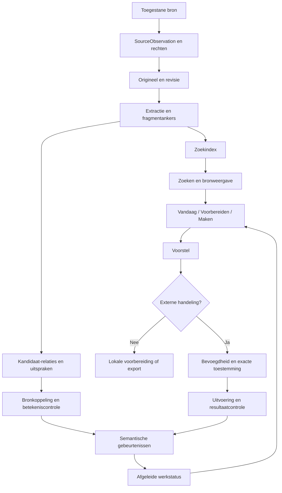

# ADR-0001: EAIhome als persoonlijke werkassistent

**Status:** voorgesteld, nog niet vastgesteld  
**Datum:** 18 november 2026  
**Documenttype:** Architecture Decision Record (product + semantiek + techniek)  
**Bronversie EAIhome:** [`fe6dfec`](https://github.com/E-AI-MODEL/EAIhome/tree/fe6dfec32a771bb9d8a6ebbb5e8859011f7785e4)  
**Besluit nodig:** acceptatie van de beschreven richting en afzonderlijke toelating van echte gegevens en externe koppelingen.

> **Te nemen beslissing.** EAIhome wordt een persoonlijke assistent die de voortgang van werk over meerdere bronnen en dagen begrijpelijk maakt. Het corpus ondersteunt dat doel, maar is niet het product. We modelleren bronnen, uitspraken, toezeggingen, taken, besluiten, correcties en acties als verschillende soorten gegevens. Elk antwoord en elk voorstel blijft verbonden met herleidbare bronnen, toegangsrechten en het tijdstip waarop iets bekend of geldig was. De gebruiker blijft verantwoordelijk voor beoordeling en externe handelingen.

Deze ADR is een **ontwerpbesluit ter beoordeling**. Een document in GitHub, een geslaagde CI-run of een uitgewerkte datastructuur betekent niet dat de beschreven functies al bestaan.

## 1. Aanleiding

EAIhome moet voorkomen dat iemand na een volle werkdag of onderbreking opnieuw mails, gesprekken, documenten en agenda's moet doorlopen om te weten waar het werk is gebleven.

De eerste implementatie is bewust klein: een lokaal bronregister, SHA-256-opslag, een `manifest.jsonl` en een SQLite FTS5-index. Het systeem bewaart versies en kan tekst vinden in TXT, Markdown, CSV, JSON en EML. De twintig fictieve mockupbestanden dienen als testmateriaal; andere formaten staan in v0.1 meestal op `unsupported_format`. Een getoond fragment zegt niets over de juistheid van een afgeleide conclusie. De CLI kent groepfilters, maar **geen geauthenticeerde gebruikersrechten**.

De vorige inhoudelijke beoordeling liet een risico zien: verder bouwen vanuit importformaten en zoekindexen zou een goed archief kunnen opleveren zonder een bruikbare persoonlijke assistent. Deze ADR corrigeert de ontwerprichting zonder bestaand werk weg te gooien.

### 1.1 Doel dat niet mag verschuiven

EAIhome helpt de gebruiker:

- 's ochtends zien wat veranderd is, wat openstaat en wat voorbereiding vraagt;
- de voorgeschiedenis van een onderwerp, persoon, afspraak of besluit terugvinden;
- in een gesprek of dossier het onderscheid zien tussen vraag, toezegging, voorstel, besluit en uitvoering;
- documenten, presentaties, overzichten en berichten maken vanuit toegestane en gecontroleerde informatie;
- de volgende werkdag voorbereiden zonder een nieuwe administratie te moeten onderhouden;
- fouten en onjuiste verbanden eenvoudig corrigeren;
- vooraf bepalen welke gegevens voor welke taak of externe handeling gebruikt mogen worden.

**Producttoets:** niet het aantal geïndexeerde bestanden, maar de mate waarin de gebruiker correct en met minder herstelwerk verder kan met bestaand werk.

### 1.2 Niet-doelen

EAIhome wordt in deze fase niet:

- een zelfstandige bron van formele school- of organisatiebesluiten;
- een vervanger van Outlook, SharePoint, Teams, agenda, documentbeheer of bestaande taakregisters;
- een onbeperkt permanent geheugen waarin alle persoonsgegevens voor altijd blijven;
- een automatische manager die taken aan anderen toewijst of berichten verstuurt;
- een assistent die inhoudelijke juistheid uit een hoge zoekscore afleidt;
- een algemene agentfabriek, kennisgraafdienst of multi-tenant SaaS zonder aangetoonde behoefte;
- een systeem dat van een technisch bewijsstatuswoord (`proven`) een juridische, bestuurlijke of wetenschappelijke waarheidsclaim maakt.

## 2. Onderzochte toestand, bronnen en bewijsgrens

| Bron | Wat werkelijk is aangetroffen | Wat daaruit **niet** volgt |
| --- | --- | --- |
| [EAIhome `store.py`](https://github.com/E-AI-MODEL/EAIhome/blob/fe6dfec32a771bb9d8a6ebbb5e8859011f7785e4/src/eaihome/store.py) | SHA-256 van originele bytes; bronrecords met familie, versie, tijd en groepslabels; eenvoudige EML-tekstextractie. | Geen veilige productieopslag, intrekking, bewaarbeleid, autorisatie of volledige documentextractie. |
| [EAIhome `search.py`](https://github.com/E-AI-MODEL/EAIhome/blob/fe6dfec32a771bb9d8a6ebbb5e8859011f7785e4/src/eaihome/search.py) | Herbouwbare SQLite FTS5-index, groepsfilter vóór ranking, bronverwijzingen en behoud van revisies. | Geen semantische relaties, betrouwbare taakstatus of controle of een passage een conclusie ondersteunt. |
| [EAIhome mockupcontract](https://github.com/E-AI-MODEL/EAIhome/blob/fe6dfec32a771bb9d8a6ebbb5e8859011f7785e4/docs/MOCKUPS.md) | Twintig fictieve bestanden in achttien formaten, één fictieve casus, twee mailberichten en twee Markdown-revisies. | Geen representatieve proef van veranderende toezeggingen of echte externe werkprocessen. |
| [EAIwork `types.ts`](https://github.com/E-AI-MODEL/EAIwork-/blob/b80d3d9afb6289d1fda8bdc14a8c890043b56e22/packages/core/src/types.ts), [`derive.ts`](https://github.com/E-AI-MODEL/EAIwork-/blob/b80d3d9afb6289d1fda8bdc14a8c890043b56e22/packages/core/src/derive.ts) | Bewijsstatus afgeleid uit gebeurtenissen, ondersteuning, tegenbewijs, herkomst en verval; modeluitvoer telt niet als onafhankelijk bewijs. | Geen direct bruikbare universele statusmachine voor werkafspraken of automatisch bewezen uitspraken. |
| [RAG-kit `retrieval.py`](https://github.com/E-AI-MODEL/-rag-eat-starter-kit/blob/1c98f0d04a179fc8df40383870c81d032385ee50/src/ragkit/retrieval.py), [`assistant.py`](https://github.com/E-AI-MODEL/-rag-eat-starter-kit/blob/1c98f0d04a179fc8df40383870c81d032385ee50/src/ragkit/assistant.py) | Tekstuele retrieval met BM25/TF-IDF; standaard één geselecteerde passage per bronfamilie. Bij hits wordt een gegenereerd antwoord niet inhoudelijk bewezen. | De bestaande selectie is ongeschikt als enige route voor 'wat veranderde tussen revisies?'. Citaten bewijzen geen semantische ondersteuning. |
| [PiM](https://github.com/E-AI-MODEL/project-pim/blob/840ad1f70b5d86eb9058b08f8d9d649b8773f243/docs/GOLDEN_PATH.md) | Browsergerichte privacycontrole en controle van uitgaande payloads; externe AI-actie in die build is simulatie. | Geen reeds aangesloten servercontrole of garantie voor EAIhome. |
| [EAT Inline v0.3.2](https://github.com/E-AI-MODEL/EAT-inline/blob/0bd184f5408bddb9211b9684d7a0ada78a593b8b/SPEC.md) | Formele `@@EAT type:key@@`-syntax voor bedoelde verwijzingen. | Geen canoniek persoonsregister, relatiesemantiek of identiteitsverificatie. |

De bovenstaande beoordeling is een gerichte inspectie van relevante code en documentatie, geen complete audit van alle repositories. De bestaande EAIhome-tests zijn eerder met fictieve data uitgevoerd; er is geen live proef met mail, agenda of vertrouwelijke inhoud uitgevoerd voor deze ADR.

## 3. Besluit: semantische werkcontinuïteit eerst

We kiezen een **contextgebonden werkmodel met getypeerde gegevens, afzonderlijke gebeurtenisgeschiedenis en herbouwbare zoekprojecties**.

Het ontwerp begint bij vier gebruikershandelingen: **Vandaag, Zoeken, Voorbereiden, Maken**. Daarachter staat één model dat onderscheid maakt tussen wat iemand zei, wat een bron laat zien, wat de assistent vermoedt, wat een bevoegde persoon heeft vastgesteld en wat werkelijk is uitgevoerd.

De belangrijkste beslissingen zijn:

1. **Werkcontext is leidend.** Informatie hoort bij een onderwerp, tijd en bevoegd gebruik. Het bestandstype bepaalt alleen hoe de bron wordt gelezen.
2. **Bronnen zijn geen opdrachten.** Een mail of document kan een mogelijke taak bevatten; het mag geen instructie aan de runtime of een automatische beslissing worden.
3. **Een semantisch voorstel is nog geen feit.** Identificatie, koppeling, inhoudelijke ondersteuning, menselijke bevestiging en uitvoering zijn gescheiden bewerkingen.
4. **Een later bericht kan de betekenis veranderen.** We registreren wat eerder bekend was en welke informatie dat aanvult, tegenspreekt, vervangt of intrekt.
5. **De bronhouder blijft gezaghebbend voor de bron.** EAIhome bewaart toegestane versies en een afgeleide werkweergave, maar wordt geen schaduwregister dat formele systemen overschrijft.
6. **Zoekindexen, grafen, samenvattingen en dashboardkaarten zijn afgeleid.** Ze mogen worden verwijderd en opnieuw opgebouwd zonder een tweede, tegenstrijdige waarheid te creëren.
7. **De mens houdt beslissings- en uitvoeringsrechten.** Lokale voorbereiding kan geautomatiseerd plaatsvinden. Verzenden, delen, wijzigen en andere externe effecten vereisen passende bevoegdheid en een op de exacte actie gerichte toestemming.
8. **Bevoegdheid geldt op het moment van gebruik.** Een bron die later niet meer toegankelijk is, mag niet uit een oude cache terugkomen.

### 3.1 Vier dingen die het systeem uit elkaar houdt

| Vraag | Type informatie | Niet verwarren met |
| --- | --- | --- |
| Wat staat er? | Bron + fragment + getypeerde uitspraak | De betekenis of juistheid ervan |
| Wat zou dit betekenen? | Hypothese, kandidaatverband, kandidaat-taak | Vaststaande afspraak of besluit |
| Wat is beoordeeld of bevestigd? | Controle of menselijke vastlegging met bevoegdheid | Automatische uitvoering |
| Wat is daadwerkelijk gebeurd? | Waargenomen gebeurtenis of bevestigd extern resultaat | Plan, voornemen of geslaagde API-aanroep zonder aflevering |

Een gebruiker kan een voorstel afwijzen zonder het bronmateriaal te wijzigen. Een later document kan een eerder besluit tegenspreken zonder de geschiedenis te wissen.

## 4. Alternatieven

| Variant | Winst | Beperking | Oordeel |
| --- | --- | --- | --- |
| A. Alleen corpus en RAG uitbreiden | Weinig nieuwe techniek; bestanden sneller vindbaar. | Geen betrouwbaar onderscheid tussen voorstel, toezegging, besluit, intrekking en werkstatus. | Afgewezen als eindarchitectuur; bestaande index blijft onderdeel. |
| B. Direct een volledige graph database en generieke agentruntime | Veel mogelijke verbindingen en automatisering. | Nieuwe opslagautoriteit, complex beheer en te weinig werkproeven om dat te rechtvaardigen. | Voorlopig afgewezen. |
| **C. Getypeerde werkobjecten, versiegebonden bronregister, eventlog en afgeleide indexen** | Houdt de gebruikerstaak centraal; hergebruik van bestaande code; traceerbare veranderingen. | Meer semantische ontwerpregels en negatieve tests nodig. | **Gekozen voorstel.** |
| D. Niets veranderen | Werkende v0.1 blijft beschikbaar. | De oorspronkelijke persoonlijke assistent ontstaat niet. | Alleen zinvol als tijdelijke stop, niet als productrichting. |

**Toets van variant C:** een kleine, moeilijke werkcasus moet betere antwoorden en minder foutieve open taken opleveren dan de huidige v0.1-zoekroute. Lukt dat niet, dan vereenvoudigen we het model of keren we voor die functie terug naar zuivere bronweergave. Een uitgebreide ontologie is geen doel op zichzelf.

## 5. Begrippen en betekenisgrenzen

De termen hieronder zijn productbetekenissen. Waar een bronproject dezelfde woorden anders gebruikt, geldt het EAIhome-contract binnen EAIhome.

| Begrip | Betekenis in EAIhome |
| --- | --- |
| **WorkContext** | Afgeschermde professionele of persoonlijke gebruikscontext met bronrechten, rollen, doelen, bewaarbeleid en toegestane uitvoer. |
| **WorkThread** | Doorlopende kwestie of werkstroom die meerdere berichten, afspraken, stukken en besluiten kan verbinden. Niet gelijk aan een e-mailthread. |
| **Source** | Een geïdentificeerde bron in een extern systeem of bij een gecontroleerde handmatige import. |
| **SourceRevision** | Concrete versie of waarneming van die bron, met herkomst, toestemming, tijd en inhoudshash. |
| **Fragment** | Verwijsbaar deel van een bronrevisie: tekstpassage, pagina, celbereik, dia, kalenderobject of transcriptsegment. |
| **Entity** | Canonieke verwijzing naar een persoon, organisatie, project, plaats of ander relevant object, binnen de toegestane context. |
| **Assertion** | Getypeerde uitspraak over een subject, relatie en object, inclusief herkomst en eventueel geldigheidsperiode. |
| **EvidenceLink** | Gerichte relatie tussen uitspraak en bronfragment: bijvoorbeeld ondersteunt, spreekt tegen of noemt. Het is een kwalificatie, geen automatisch waarheidsbewijs. |
| **Commitment** | Mogelijke of bevestigde toezegging door een actor, gericht op een te verrichten handeling of resultaat. |
| **Task** | Werkpunt dat als voorstel kan ontstaan, maar pas na bevestiging als aanvaard werk wordt behandeld. |
| **Decision** | Voorstel, bespreking of vastgesteld besluit, met vastleggende actor en bevoegdheid. |
| **CalendarEvent** | Agenda-afspraak uit een kalender. Niet hetzelfde als een werkelijke deelname of voltooid overleg. |
| **WorkEvent** | Registratie van een gebeurtenis zoals toezegging gedaan, termijn verplaatst, besluit ingetrokken of taak afgemeld. |
| **ActionProposal** | Volledig gespecificeerde mogelijke externe handeling, zonder uitvoeringsrecht. |
| **Approval** | Expliciete toestemming van een bevoegde actor voor exact één actie of begrensde serie onder opgegeven voorwaarden. |
| **ExecutionReceipt** | Geregistreerd resultaat van uitvoering, inclusief bevestiging door het doelsysteem of de onzekerheid daarover. |
| **Annotation/Correction** | Menselijke aanvulling, afwijzing, betekeniscorrectie of identiteitscorrectie die niet stilzwijgend de bron herschrijft. |

### 5.1 Geen betekenisverschuivingen

- **Onthouden** betekent hier dat gegevens terugvindbaar blijven zolang opslag en toestemming geldig zijn. Het betekent niet dat een AI-model iets menselijk heeft geleerd.
- **Een taak vinden** betekent dat tekst op een mogelijke opdracht wijst. Het betekent niet dat die opdracht geldig, toegewezen of open is.
- **Een persoon herkennen** betekent een mogelijke identiteitskoppeling. Dezelfde naam of hetzelfde e-mailadres in twee omgevingen is niet voldoende om één identiteit te maken.
- **Een bron citeren** betekent dat een fragment is gevonden. Het betekent niet dat het fragment de conclusie inhoudelijk ondersteunt.
- **Gecontroleerd** benoemt een uitgevoerde toets met een bekende reikwijdte. **Proven** uit EAIwork is een intern statuslabel en betekent geen algemene zekerheid.
- **Bevestigd** kan slaan op de interpretatie van een taak, de autoriteit van een besluit of een externe aflevering. Die drie bevestigingen hebben afzonderlijke actoren en gebeurtenissen nodig.
- **Verwijderd** kan betekenen: verwijderd bij de provider, niet meer toegankelijk, lokaal gewist of uit de zoekindex gehaald. Die toestanden zijn niet uitwisselbaar.

## 6. Semantisch gegevensmodel

### 6.1 Identiteit en naamruimten

Elk eigen record krijgt een **onveranderlijke, betekenisloze ID**, bijvoorbeeld UUIDv7 of ULID met een typeprefix. De keuze tussen deze twee ID-formaten wordt bij implementatie vastgelegd; dit ADR schrijft de betekenisloze identiteit en uniciteit voor, niet een bibliotheek.

- `ctx_*`: gebruikscontext.
- `src_*`: bronidentiteit.
- `rev_*`: versie of observatie van een bron.
- `frag_*`: vindbaar fragment.
- `ent_*`: canonieke entiteit binnen een context.
- `thread_*`: doorlopend werkonderwerp.
- `assert_*`: uitspraak.
- `evidence_*`: bewijsrelatie.
- `commit_*`: toezegging.
- `task_*`: werkpunt.
- `decision_*`: besluit.
- `action_*`, `approval_*`, `receipt_*`: voorgestelde, toegestane en uitgevoerde handeling.
- `evt_*`: gebeurtenis in het semantische logboek.

Een provider-ID wordt apart bewaard als `(connector_id, tenant_id, resource_type, external_id, revision_token?)`. Een bestandsnaam, SHA-256, persoonsnaam of e-mailadres is **geen canonieke record-ID**. Een bronhash identificeert uitsluitend bepaalde bytes.

Identiteitskoppeling heeft een eigen status: `unresolved`, `candidate`, `confirmed`, `rejected`. Alleen expliciet toegestane identiteitsinformatie mag voor resolutie worden gebruikt. Afwijzingen voorkomen dat hetzelfde onjuiste verband bij herhaalde verwerking terugkomt. Aliaswijzigingen blijven gedateerd.

### 6.2 Minimale recordcontracten

| Type | Verplichte betekenisvelden | Beheerregel |
| --- | --- | --- |
| `WorkContext` | `id`, `purpose`, `owner_ref`, `allowed_sources`, `policy_ref`, `retention_ref` | Toegang en doel bepalen welke gegevens verwerkt en getoond mogen worden. |
| `Source` | `id`, `context_id`, `connector_id`, `external_ref`, `source_kind`, `authority_hint` | Externe bronidentiteit blijft herkenbaar bij verplaatsing of revisie. |
| `SourceRevision` | `id`, `source_id`, `content_sha256`, `observed_at`, `source_modified_at?`, `access_snapshot_ref`, `lifecycle` | Nieuwe inhoud is een nieuwe versie; een oude versie wordt niet herschreven. |
| `Fragment` | `id`, `revision_id`, `locator`, `extractor_version`, `extraction_quality`, `extracted_text_ref?` | Vindplaats kan opnieuw worden geopend en gecontroleerd, of wordt als onbeschikbaar gemeld. |
| `Entity` | `id`, `context_id`, `entity_kind`, `resolution_status`, `alias_refs` | Koppeling is contextgebonden en herroepbaar. |
| `WorkThread` | `id`, `context_id`, `title`, `member_refs`, `state_annotation?` | Projecteert samenhang; het onderwerp zelf kan menselijke correcties ontvangen. |
| `Assertion` | `id`, `subject_ref`, `predicate`, `object_ref_or_value`, `modality`, `valid_time?`, `origin_kind` | Bewering, hypothese, vraag en voorstel krijgen niet dezelfde betekenis. |
| `EvidenceLink` | `id`, `assertion_id`, `fragment_id`, `stance`, `origin_lineage`, `assessment_state`, `assessed_by?` | Eén herkomst telt nooit automatisch als meerdere onafhankelijke bevestigingen. |
| `Commitment` | `id`, `promisor_ref?`, `beneficiary_ref?`, `action_description`, `due_at?`, `source_assertion_refs`, `lifecycle` | Zonder voldoende actor/handeling/bewijs blijft dit een kandidaat. |
| `Task` | `id`, `context_id`, `workthread_id?`, `origin_refs`, `assignee_ref?`, `due_at?`, `lifecycle` | Een vermoeden wordt niet zonder toestemming een geaccepteerde taak. |
| `Decision` | `id`, `scope_ref`, `proposal_ref?`, `decider_ref?`, `authority_ref?`, `effective_at?`, `lifecycle` | Het systeem legt besluitvorming vast, maar kent geen eigen bestuurlijke bevoegdheid. |
| `ActionProposal` | `id`, `actor_ref`, `target_system`, `operation`, `payload_hash`, `preconditions`, `expires_at` | Een actievoorstel is technisch niet uitvoerbaar zonder geldige toestemming. |
| `Approval` | `id`, `action_id`, `approver_ref`, `approved_payload_hash`, `authority_scope`, `valid_until` | Goedkeuring geldt voor exact die payload en toestand. |
| `ExecutionReceipt` | `id`, `action_id`, `attempt_id`, `provider_ref?`, `delivery_state`, `observed_at` | Verzending, ontvangst, uitvoering en bevestiging blijven apart. |
| `WorkEvent` | `id`, `record_type`, `subject_id`, `event_kind`, `actor`, `payload_ref`, `recorded_at`, `revision_no` | Nieuwe toestand ontstaat uit geldige gebeurtenissen, niet uit verborgen UI-mutaties. |

### 6.3 Relatiewoordenboek

Een relatie is een getypeerde, gericht leesbare verbinding. Het systeem registreert per relatietype het toegestane subject, object, betekenis, bewijsvereiste en het gedrag bij vervallen bronnen.

| Predicate | Van → naar | Betekenis |
| --- | --- | --- |
| `mentions` | Fragment → Entity | De tekst verwijst mogelijk naar de entiteit; dit is geen relatie tussen twee mensen. |
| `belongs_to` | Source/Task → WorkThread | Hoort bij een werkonderwerp volgens expliciete of beoordeelde koppeling. |
| `replies_to` | SourceRevision → SourceRevision | Bericht reageert op een ander bericht volgens providerheaders of onderbouwde koppeling. |
| `supersedes` | SourceRevision/Decision → eerder record van gelijk type | Later record vervangt een eerder record binnen de opgegeven reikwijdte. |
| `amends` | WorkEvent/Decision → bestaand record | Wijzigt een onderdeel, niet noodzakelijk de volledige afspraak. |
| `retracts` | WorkEvent → Assertion/Commitment/Decision | Betrokken uitspraak of handeling is ingetrokken door een actor met toereikende bron/autoriteit. |
| `supports` | EvidenceLink → Assertion | Bronfragment geeft volgens een geregistreerde beoordeling ondersteuning. |
| `contradicts` | EvidenceLink → Assertion | Bronfragment levert tegenstrijdige informatie; conflict wordt zichtbaar. |
| `is_assigned_to` | Task → Entity | Geaccepteerde toewijzing, niet afgeleid uit alleen een aanhef. |
| `fulfills` | WorkEvent → Commitment/Task | Waargenomen of bevestigd resultaat voldoet aan de afspraak. |
| `depends_on` | Task → Task | Een taak kan pas verder wanneer een andere is voldaan. |
| `derived_from` | Summary/OutputArtifact → SourceRevision/Fragment/Assertion | Herkomst van een gemaakt resultaat; geen zelfstandige bevestiging. |
| `not_same_as` | Entity → Entity | Beoordeelde afwijzing van een foutieve identiteitskoppeling. |

Predicaten zijn niet vrij invulbaar door een model. Een versiegebonden **predicate-registry** bevat domein, bereik, cardinaliteit, inverse relaties, toegestane actor en statusovergangen. Nieuwe predicaten vereisen een schemaversie en migratieregel. Een cyclus in `depends_on` is ongeldig. `supersedes` mag geen tijds- of identiteitscirkel maken. De relatie `supports` mag niet worden afgeleid uit alleen dezelfde trefwoorden.

### 6.4 Gebeurtenissen, voorstellingen en gezag

De huidige toestand van een `Task`, `Commitment` of `Decision` wordt afgeleid uit geldige `WorkEvent`-records. De gebeurtenis bevat:

- een stabiele gebeurtenis-ID en een idempotency-sleutel;
- actorsoort (`person`, `connector`, `system`, `model`, `check`) en controleerbare actoridentiteit waar vereist;
- het bedoelde record, de verwachte recordversie en de aanleiding;
- bron- of toelatingsverwijzingen;
- werkelijke registratietijd, eventuele gebeurtenistijd en beoogde geldigheidsperiode;
- een nieuwe toestand of correctie met duidelijke reden;
- beleidssnapshot en resultaat van de bevoegdheidscontrole.

Een model mag `candidate.proposed` schrijven als dat binnen zijn ingestelde bevoegdheid valt. Een model mag niet namens de gebruiker `decision.decided`, `task.accepted`, `approval.granted` of `action.delivered` registreren. De server controleert dit als een afdwingbare regel, niet als tekst in een prompt.

## 7. Tijd: wat gold en wat wisten we toen?

Een werkassistent moet twee verschillende vragen kunnen beantwoorden:

- **Wat gold op 12 november?** De op die datum geldende afspraak of beslissing.
- **Wat wisten we op 12 november?** Welke gegevens op die dag al waren ontvangen en gecontroleerd.

Deze vragen verschillen bij een besluit dat later met terugwerkende kracht wordt vastgelegd.

Daarom bewaren we, waar van toepassing, de volgende tijden afzonderlijk:

| Tijdveld | Betekenis |
| --- | --- |
| `occurred_at` | Wanneer een bron zegt dat iets plaatsvond. |
| `source_created_at`, `source_modified_at` | Providergegevens over aanmaak/wijziging. |
| `observed_at` | Wanneer de connector de bron zag. |
| `ingested_at` | Wanneer EAIhome de bron lokaal vastlegde. |
| `recorded_at` | Wanneer de semantische gebeurtenis is geregistreerd. |
| `valid_from`, `valid_to` | Periode waarin de afspraak of bewering bedoeld geldig is. |
| `effective_at` | Formele ingangsdatum van een besluit of wijziging. |
| `due_at` | Gewenste einddatum van een taak, geen gebeurtenistijd. |
| `expires_at` | Uiterste geldigheid van toestemming of beoordeling. |

Alle opgeslagen tijdstippen zijn timezone-aware; presentatie gebeurt in de contexttijdzone. Onbekende waarden blijven `null`, niet een verzonnen datum. Bij onzekere tijden wordt precisie apart vermeld, bijvoorbeeld `day` in plaats van `instant`.

**Querycontract:** `as_known_at` en `as_effective_at` zijn verschillende filters. Zonder gespecificeerde tijd gebruikt een actueel overzicht de laatste toegestane stand en vermeldt het veroudering of onvolledige synchronisatie. Een gedeeltelijke sync kan geen afwezigheid van een afspraak bewijzen.

## 8. Levenscycli en overgangsvoorwaarden

### 8.1 Bronnen en extractie

Bronlevenscyclus: `active`, `access_revoked`, `source_removed`, `retention_hold`, `erasure_pending`, `erased`.

Verwerkingstatus per revisie: `received`, `processed`, `partial`, `unsupported_format`, `failed`, `quarantined`.

Deze twee assen worden gescheiden. `processed` betekent dat extractie afgerond is, niet dat de bron beschikbaar mag blijven of dat de inhoud juist is.

### 8.2 Beweringen en bewijs

Voor een `Assertion` registreren we minimaal:

- `modality`: `question`, `hypothesis`, `reported`, `proposed`, `asserted`, `observed`;
- `assessment`: `unreviewed`, `supported`, `contradicted`, `disputed`, `insufficient`, `stale`, `withdrawn`;
- bewijslinks en de methode waarmee een beoordeling tot stand kwam.

De status wordt per vraag afgeleid en bewaart wie welke beoordeling deed. Een tekstmatch geeft standaard `unreviewed`; een modelscore is niet hetzelfde als een geaccepteerde inhoudelijke toets. Een tegensprekende bron blijft zichtbaar, ook als een andere bron recenter is.

EAIwork heeft voor afgebakende atomen de ladder `unknown → assumption → claim → observed → checked → proven`. We kunnen de **afleidingsregels** hergebruiken waar het toetsobject overeenkomt, maar die ladder wordt niet rechtstreeks het levenscyclusmodel voor formele besluiten en werkafspraken. `proven` mag in de gebruikersinterface alleen met uitleg van de specifieke check en haar grenzen verschijnen.

### 8.3 Toezegging, taak en besluit

| Object | Geldige toestanden | Belangrijke voorwaarde |
| --- | --- | --- |
| `Commitment` | `candidate`, `reported`, `confirmed`, `fulfilled`, `cancelled`, `disputed`, `unknown` | `confirmed` vereist herleidbare actor/uitspraak of menselijke verificatie. |
| `Task` | `proposed`, `accepted`, `in_progress`, `completed`, `dismissed`, `expired`, `blocked` | `completed` vereist vastlegging van voltooiing, niet alleen een verstuurde herinnering. |
| `Decision` | `proposed`, `discussed`, `decided`, `recorded`, `amended`, `withdrawn`, `disputed` | `decided` vereist expliciete vastlegging van actor, bevoegdheid en besluitinhoud. |
| `ActionProposal` | `draft`, `ready_for_review`, `approved`, `queued`, `attempted`, `acknowledged`, `failed`, `uncertain`, `cancelled` | Een ontvangst- of providerbevestiging is iets anders dan inhoudelijke afhandeling. |

`expired` betekent bij een taak dat een gestelde geldigheid is verstreken; een **verlopen deadline** mag niet automatisch de taak zelf afsluiten. Het gebruikersbeeld kan daarom apart `overdue: true` tonen. Datums, levenscyclus en prioriteit vormen onafhankelijke dimensies.

### 8.4 Geen stille promotie

Alle promoties naar bevoegdheidsgevoelige toestanden vereisen een valide `WorkEvent`, een bevoegde actor en een verwachte recordversie. Bij gelijktijdige wijzigingen wint niet automatisch de laatste schrijver: het systeem meldt het conflict en laat gericht opnieuw beoordelen.

## 9. Opslag en afleidingen

### 9.1 Drie opslagrollen

1. **Bronopslag (EAIbase):** toegestane origineelbytes en source revisions in een afgeschermde opslag. De bronhouder, niet EAIhome, blijft gezaghebbend voor externe wijzigingen en toegang.
2. **Semantisch gebeurtenislog:** getypeerde beslissingen, correcties en statuswijzigingen met actor, context, tijd, herkomst en versieverwachting.
3. **Herbouwbare projecties:** SQLite-tabellen, full-text-index, optionele vectorindex, relationele graaf, dagoverzicht en outputcache.

De opslag van originele bytes is **niet eeuwig immutabel**. Zolang een bron volgens beleid bewaard mag worden, veranderen de bytes niet binnen die revisie. Verwijdering en intrekking worden daadwerkelijk uitgevoerd; het auditspoor bewaart alleen toegestane, geminimaliseerde metadata. Ook metadata kunnen persoonsgegevens zijn en vallen onder het verwijderbeleid.

### 9.2 Begin klein

Voor de eerste lokale proef is SQLite voldoende voor bronmetadata, events, relaties en FTS5, mits transacties, herstel en migraties zijn getest. Een aparte graph database, vector database, queue of PostgreSQL-installatie is **geen uitgangspunt**. We voegen die pas toe als een gemeten beperking of multi-userbehoefte dat vereist.

Het huidige `manifest.jsonl` blijft leesbaar en kan naar de nieuwe `Source`/`SourceRevision`-contracten worden gemigreerd. Oude velden worden expliciet gemapt; een onbepaald veld wordt `unknown` in plaats van achteraf ingevuld.

### 9.3 Menselijk leesbare bestanden en één bron van waarheid

Markdown met YAML-frontmatter is bruikbaar voor handmatige bronbeschrijvingen, annotaties, inspectie en export. Het is **niet** tegelijk een zelfstandig besluitregister naast het eventlog. Een gecontroleerde wijziging in zo'n bestand wordt omgezet in een gevalideerde semantische gebeurtenis. Het eventlog is vervolgens leidend voor geaccepteerde toestand. Dat voorkomt concurrerende versies van een besluit.

JSON Schema Draft 2020-12 beschrijft straks de vorm van iedere recordsoort; schemavalidatie alleen bewijst geen semantische juistheid. Relations en provenancemetadata kunnen later als JSON-LD / W3C PROV-O worden geëxporteerd. We bouwen niet nu al een RDF-triplestore.

### 9.4 Integriteit en herstel

SHA-256 controleert de gelijkheid van opgeslagen bytes met een bekende hash. Het bewijst niet wie de bron schreef of dat die bron waar is. Het eventlog krijgt sequence numbers, vorige-revisieverwachting, consistente transacties en een herstelscenario voor onderbroken writes. Een eventuele hashketen of extern witness-mechanisme krijgt een eigen dreigingsmodel en tests voordat we 'tamper proof' claimen.

## 10. Contract voor bronadapters

Een adapter levert een bronwaarneming, **geen kant-en-klare taak of toegangsbeslissing**.

Verplicht contract per adapter:

```json
{
  "contract": "eaihome.source-observation.v1",
  "connector_id": "manual-demo",
  "context_id": "ctx_demo",
  "external_ref": {
    "tenant": "demo",
    "resource_type": "email",
    "id": "message-demo-1",
    "revision_token": "r1"
  },
  "observed_at": "2026-11-18T09:10:00+00:00",
  "sync_state": "complete",
  "operation": "upsert",
  "source_status": "active",
  "content_type": "message/rfc822",
  "content_sha256": "SHA256_OF_EXACT_BYTES_FROM_IMPORT",
  "content_ref": "local://scope/demo/object/...",
  "access_snapshot_ref": "acl_demo_1",
  "provenance": {
    "retrieval_method": "manual_import",
    "actor_kind": "person"
  }
}
```

Dit is een **voorbeeld van de voorgestelde vorm**, niet een reeds bestaande API. Het placeholder-hashveld is geen geldige echte SHA-256 en mag bij implementatie niet door schemavalidatie komen.

Adapterregels:

- Een volledige provideridentiteit omvat tenant/context, type en externe sleutel; nooit alleen een onderwerpregel of bestandsnaam.
- Idempotente import: dezelfde providerrevisie en dezelfde bytes levert geen nieuwe onafhankelijke waarneming op.
- Een identieke bijlage in twee toegangscontexten maakt geen gedeelde autorisatie. Deduplicatie is maximaal een interne opslagoptimalisatie **binnen een toegestane beveiligingsscope**.
- De adapter meldt paginaresultaten, watermark/delta-cursor, volledigheid en fouten. Een ontbrekend item in een onvolledige sync mag niet als verwijderd worden beschouwd.
- Providerverwijdering, revocation, expiratie en gewijzigde rechten krijgen afzonderlijke gebeurtenissen. Oude indexvermeldingen en gegenereerde samenvattingen worden opnieuw beoordeeld.
- Extractors werken op werkelijk MIME-/bestandsinhoud, niet alleen extensies; houden parser-, OCR- en transcriptversie bij en melden ontbrekende pagina's of onzekerheid.
- Een PDF-/DOCX-tekstextractie zonder relevante pagina of sectie kan geen nauwkeurige bronverwijzing opleveren. Bij onvoldoende dekking meldt het systeem de beperking.
- Connectorcode en extractors behandelen alle externe inhoud als onbetrouwbare data. Een bron kan geen serverrechten of nieuwe systeeminstructies leveren.

**M365 als latere adapter:** Microsoft Graph heeft delta-queryroutes voor onder meer berichten en agenda-items, met resource-specifieke beperkingen. Een implementatie moet de actuele ondersteunde scopes, tokenlevensduur, paging en verwijderingen testen. Er is nu **geen** live Graph-koppeling in EAIhome. Zie [Microsoft Graph delta overview](https://learn.microsoft.com/graph/delta-query-overview), [message delta](https://learn.microsoft.com/en-us/graph/api/message-delta), [event delta](https://learn.microsoft.com/en-us/graph/api/event-delta).

## 11. Extractie, fragmenten en herleidbaarheid

De eerste pipeline heeft twee paden:

**Bronpad:** `ingest -> hash -> scope/rights -> extract -> fragments -> index -> integrity check`.

**Betekenispad:** `fragments -> kandidaat-entiteiten/relaties/uitspraken -> evidence mapping -> controle -> projecties -> menselijk gebruik`.

Deze paden delen bron-ID's, maar een fout in de betekenislaag mag de originele bron niet wijzigen.

Een fragmentanker bevat minimaal `revision_id`, `extractor_version`, `locator_kind`, `locator`, `content_digest` en `extraction_quality`. Locators kunnen zijn:

- `text`: begin/eindpositie op een vastgelegde genormaliseerde tekstversie, met exact fragmenthash;
- `pdf`: pagina, tekstblok en eventueel bounding box, inclusief extractie-/OCR-methode;
- `docx`: paragraaf-/tabelidentiteit waar mogelijk, met teksthash en fallbackpositie;
- `xlsx`: tabblad-ID, celbereik, formule/waarde-onderscheid en workbookrevisie;
- `pptx`: dia-ID en object-/tekstbereik;
- `eml`: Message-ID, MIME-part, header of tekstdeel, plus berichtrevisie;
- `ics`: UID, recurrence-id, occurrence en eigenschap;
- `audio/transcript`: tijdsbereik, sprekerhypothese, transcriptversie en onzekerheid.

Een nieuw extractormodel kan andere fragmentgrenzen geven. Oude verwijzingen blijven naar de oude revisie en extractie verwijzen of worden expliciet als niet meer te reconstrueren gemeld. We verplaatsen citaten niet stilzwijgend naar een nieuw tekstfragment.

**Belangrijk:** het WAV-testbestand bevat alleen een toon. Het test de bestandsroute, niet diarization, toestemming voor opname of spraakherkenning.

## 12. Retrieval en antwoorden

### 12.1 Een vraag heeft een zoekmodus

| Modus | Vraag | Gedrag |
| --- | --- | --- |
| `source_lookup` | Waar staat dit? | Geeft fragmenten met bron, versie en vindplaats. |
| `current_view` | Wat is nu de stand? | Gebruikt actuele, toegestane en niet-ingetrokken bronnen; laat conflicten zien. |
| `history` | Hoe is dit veranderd? | Behoudt alle relevante revisies, intrekkingen en wijzigingsgebeurtenissen. |
| `as_known_at` | Wat wisten we toen? | Filtert op op dat moment geregistreerde en toegestane waarnemingen. |
| `as_effective_at` | Wat gold toen? | Filtert op inhoudelijke geldigheidsperiode, niet alleen registratiedatum. |
| `work_status` | Wat staat nog open? | Gebruikt bevestigde werkstatus en meldt kandidaten apart. |
| `prepare` | Wat heb ik nodig voor dit overleg? | Combineert agenda, werkonderwerp, documenten en ontbrekende items. |
| `compose` | Maak een document of presentatie. | Selecteert toegestane feiten en herleidbare bronnen vóór productie. |

De gebruiker kan tussen actueel en historisch zoeken wisselen. De applicatie kiest niet overal automatisch de laatste revisie. In de huidige RAG-kit kan de `family`-selectie oudere versies wegdrukken; die logica mag niet als standaard worden overgenomen.

### 12.2 Zoekvolgorde

1. Bepaal gebruiker, werkcontext, doel en toegestane bronnen.
2. Beoordeel bron- en fragmentrechten **vóór** retrieval en rangschikking.
3. Filter op tijd, levenscyclus, volledigheid, betrokken werkonderwerp en gewenste zoekmodus.
4. Zoek met exacte termen, FTS/BM25 en beschikbare gestructureerde relaties; voeg vectorzoekwerk alleen toe wanneer dat meetbaar helpt.
5. Vergelijk relevante bronnen, versies en origin-lijnen. Toon tegenbewijs en ontbrekende gegevens.
6. Stel per antwoordbewering vast welk fragment de specifieke bewering **daadwerkelijk** ondersteunt. Ongecontroleerde modelbeoordelingen worden als zodanig gemarkeerd.
7. Bouw het antwoord met per bewering bronverwijzingen en een zichtbare beperking waar ondersteuning ontbreekt.
8. Toon geen broninhoud, samenvatting, taaklabel of entiteitsnaam die de actor niet mag zien.

Een zoekhit is geen inhoudelijke ondersteuning. Wanneer de volledige vraag niet wordt gedragen, geeft EAIhome een gedeeltelijk antwoord of zegt dat het niet verantwoord kan worden vastgesteld. Een lege index of bronachterstand wordt niet vertaald naar 'er is niets meer open'.

### 12.3 Geen geforceerde totaalscore

EAIhome mag technische rankingscores berekenen voor vindbaarheid en prioriteit. Een algemene 'waarheidsscore' of 'autonomiescore' wordt niet ingevoerd. We tonen waar nodig afzonderlijk relevantie, recency, extractiekwaliteit, bewijsstatus, status van sync en menselijke beoordeling.

## 13. Product: vier bruikbare ingangen

### Vandaag

Toont maximaal een beheerste selectie van signalen: nieuwe of veranderde toezeggingen, geaccepteerde taken, naderende afspraken, ontbrekende voorbereiding en conflicterende informatie. Iedere kaart heeft een korte reden, datum, bron en een bewerking als 'bekijk', 'corrigeer', 'niet relevant' of 'bereid voor'.

Kandidaat-taken zijn duidelijk **voorstellen**. Een melding wordt niet urgenter omdat dezelfde bron drie keer is geïmporteerd. Het systeem toont ook wanneer synchronisatie onvolledig is. Niets te melden is een geldig resultaat.

### Zoeken

Zoekt niet alleen bestanden maar reconstrueert een `WorkThread`: betrokkenen, gebruikte termen, tijdlijn, bronrevisies, betwiste uitspraken, besluiten en open vragen. De gebruiker ziet gemakkelijk de oorspronkelijke bron en kan onjuiste koppelingen afwijzen.

### Voorbereiden

Maakt een werkoverzicht bij een agenda-item of nieuw overleg: relevante stukken, vorige toezeggingen, vragen, mogelijke bespreekpunten, onbekenden en wie waarvoor verantwoordelijk is volgens de bron. Het voorstel mag geen ontbrekende documenten verzinnen.

### Maken

Maakt mails, rapporten, Word/PDF/Excel/HTML of presentaties uit expliciet toegestane gegevens. De export bevat, afhankelijk van bestemming en privacybeleid, bronverwijzingen of een afzonderlijk niet-meegestuurd bronregister. De gebruiker kan de inhoud vóór verzending wijzigen. Exporteren naar lokale opslag is niet hetzelfde als delen met een derde.

Dezelfde werkcontext en bewijsbeperkingen gelden in alle vier ingangen. Het dashboard is een projectie van de werkstatus, niet een aparte bron waar de toestand nogmaals moet worden bijgehouden.

## 14. Toestemming en uitvoering

### 14.1 Twee soorten automatisering

**Automatisch voorbereiden binnen toegestaan bereik:** bronnen synchroniseren, tekst extraheren, indexeren, lokale verschillen berekenen en *voorstellen* klaarzetten. Dit krijgt begrensde tijd, bronnen, kosten, logging en een stopmogelijkheid.

**Handelingen met extern of moeilijk omkeerbaar effect:** berichten versturen, afspraken wijzigen, documenten delen, brongegevens overschrijven, mensen informeren of rechten wijzigen. Dit vereist aparte toestemming en voldoende bevoegdheid.

De scheiding wordt in server- en adapterrechten afgedwongen. Een prompt 'vraag altijd eerst toestemming' volstaat niet.

### 14.2 Twee-fasencontract

**Voorstellen:** bouw een `ActionProposal` met onveranderlijke payloadhash, doel, actor, relevante bronversies, gevolgen, vereiste rechten en verloopdatum. Toon exact wat zal gebeuren.

**Goedkeuren:** controleer identiteit, werkcontext, actuele rechten, doel, payloadhash, bronversies, status en toestemming. Daarna mag de bevoegde uitvoeringsadapter de actie één keer binnen het geldige mandaat proberen. Audit registreert de poging en de externe response.

Na wijzigingen in ontvanger, inhoud, bijlage, doel of rechten vervalt de toestemming. Een klik op 'goedkeuren' maakt geen inhoudelijke bewering bewezen.

Herhaling na timeout vereist idempotency- en reconcile-regels. Zonder betrouwbare providerbevestiging is de toestand `uncertain` en volgt inspectie, niet blind opnieuw verzenden. Claim geen 'exactly once' zonder provider- en transactiebewijs.

### 14.3 Voorbeeldcontract voor een voorstel

```json
{
  "schema": "eaihome.action-proposal.v1",
  "id": "action_demo_001",
  "context_id": "ctx_demo",
  "target_system": "demo-mailbox",
  "operation": "draft_message",
  "recipient_ref": "ent_demo_colleague",
  "payload_ref": "private://drafts/demo-001",
  "payload_sha256": "SHA256_OF_EXACT_DRAFT",
  "depends_on": ["task_demo_001"],
  "approval_state": "not_requested",
  "execution_state": "not_started",
  "effects": ["creates_local_draft"],
  "expires_at": "2026-11-21T12:00:00+01:00"
}
```

Ook dit is uitsluitend een **voorgesteld contract**. De hash- en opslagvelden zijn illustratief en pas bij een uitvoerbaar schema geldig.

## 15. Context, privacy en beveiliging

De repo EAIhome is op dit moment **openbaar**. Dat mag voor code, documentatie, schema's en volledig fictieve testgegevens. Een latere overgang naar private maakt eerder openbaar gepubliceerde inhoud niet ongedaan.

### 15.1 Werkomgevingen scheiden

Persoonlijke projecten, schoolwerk en samenwerkingen krijgen gescheiden `WorkContext`-records met expliciete toegestane bronnen, doelen en uitvoerbestemmingen. Het bezit van een token met technisch brede rechten geeft EAIhome niet automatisch het recht alle beschikbare gegevens te verzamelen. Rechten worden zo klein mogelijk toegekend, bij voorkeur namens de gebruiker waar passend.

Autoriseer bij **ingest, extractie, indexering, retrieval, modelinvoer, export en uitvoering**. Voor elk modelverzoek wordt een toegestane, begrensde context opgebouwd. Namen en fragmenten uit een andere werkcontext mogen geen ongeautoriseerde metadata lekken, ook niet via autocomplete, aantallen, embeddings of een samenvatting.

### 15.2 Gegevens van derden en gesprekken

Voor persoonsgegevens, in het bijzonder school-/leerlinginformatie, moet vóór echte import zijn vastgesteld wat het doel is, welke rechtsgrond en rol van toepassing zijn, wie verwerkingsverantwoordelijk is, welke opslag en leverancier mogen worden gebruikt, welke bewaartermijn geldt en of aanvullende beoordeling nodig is. Die toets kan niet door EAIhome zelf worden ingevuld.

Een opname of transcript van een collegiaal gesprek vereist vooraf een passende juridische en organisatorische grondslag en duidelijke afspraken over toegang en verwerking. Geen automatische opname omdat er een agenda-item bestaat.

### 15.3 Privacycontrole en modeluitvoer

PiM is een relevante bron voor detectie en controle van uitgaande gegevens, maar de huidige browserimplementatie is **niet** zonder aanpassing een vertrouwde servergate. Hergebruik vraagt een gespecificeerd invoer-/uitvoercontract, lokale tests, echte uitgaande-actietests en controle van hosting, modellen en beleidsregels.

Ruwe gegevens worden niet standaard naar externe modelproviders gestuurd. Providerkeuze, gegevensverwerking, regio, retentie en toestemming worden per werkcontext vastgelegd. Ook lokale modellen krijgen alleen de data die nodig zijn voor hun specifieke taak.

### 15.4 Intrekking, verwijdering en herstel

Een intrekking van toegang blokkeert nieuwe zoek-, model- en uitvoeracties direct. Het systeem ruimt vervolgens afgeleide tekst, indexen, vectoren, samenvattingen en caches op volgens het geldende beleid. Oude rapporten die reeds zijn gedeeld, zijn een apart uitvoerrisico en moeten zichtbaar kunnen worden herleid.

Een rechtmatige verwijdering of verstreken bewaartermijn kan ook betekenen dat origineelbytes en afgeleide persoonsgegevens moeten verdwijnen. Een append-only log is **geen uitzondering** op deze verplichting. Bewaar uitsluitend noodzakelijk geautoriseerde auditmetadata, eveneens met bewaarbeleid. Waar nodig worden sleutels per scope of record beheerd zodat doelgerichte verwijdering mogelijk is; crypto-erasure is pas voldoende na toets van alle kopieën en backups.

### 15.5 Dreigingen die negatief getest worden

- promptinjectie in mail, PDF, website of bijlage;
- gekopieerde bron die als tweede onafhankelijke bevestiging wordt geteld;
- verwisselde personen met dezelfde naam;
- oude of ingetrokken bron die via een samenvatting alsnog zichtbaar wordt;
- groepfilter dat via caller-input geveinsd wordt;
- vermenging van twee tenants of professionele contexten;
- onvolledige synchronisatie die tot 'geen taken' leidt;
- onjuiste 'taak afgerond' door alleen een antwoordmail;
- oude goedkeuring die na wijziging van inhoud toch wordt gebruikt;
- twee gelijktijdige bevestigingen of dubbele verzending na timeout;
- verwijdering die blobs wist maar embeddings en exportcache laat bestaan;
- onveilige documentextractie of malware in bijlagen;
- manipulatie van eventlog of rollback naar een ongeldige snapshot.

## 16. Semantische casus: dezelfde afspraak door de tijd

De huidige fictieve Project Atlas-data vormen de basis. We voegen een **testtijdlijn** toe:

| Moment | Fictieve bron | Gevraagde interpretatie |
| --- | --- | --- |
| 18 nov. 09.00 | Collega vraagt om agenda vóór 20 nov. te controleren. | `TaskCandidate`, niet vanzelf een toegekende of aanvaarde taak. |
| 18 nov. 10.00 | Antwoord: 'Ik controleer de agenda vrijdag.' | Mogelijke toezegging door afzender; inhoud, actor en termijn moeten blijken uit het bericht. |
| 19 nov. 08.00 | Latere mail: stukken zijn nog niet gereed. | De toezegging en taak kunnen gedeeltelijk verschillen; geen automatische voltooiing. |
| 19 nov. 15.00 | Verslag: voorstel is besproken maar niet besloten. | `Decision.discussed`, nooit `decided`. |
| 20 nov. 09.00 | Expliciete annulering van het overleg. | Agenda-event wordt gewijzigd; dit trekt een aparte toezegging niet automatisch in. |
| 20 nov. 11.00 | Bevoegde betrokkene bevestigt dat ACT-001 is afgerond. | Pas nu kan een passende `task.completed`-registratie worden voorgesteld of vastgelegd volgens de ingestelde bevoegdheid. |

Bij de vraag **'Wat stond er op 19 november nog open?'** moet EAIhome de beschikbare stand *zoals toen bekend* reconstrueren. Bij **'Wat staat nu open?'** moet het systeem latere correcties verwerken. Bij **'Waarom?'** toont het de exacte bronfragmenten, onzekerheid en latere wijzigingen.

De gebruiker mag de interpretatie van een bericht corrigeren: 'Dit was een suggestie, geen toezegging.' Die correctie krijgt herkomst en verhindert hernieuwde promotie door dezelfde bron bij een volgende indexbouw.

## 17. Inname en gebruik: twee complete routes



**Inname** kan automatisch verlopen binnen verleende rechten. **Gebruiken** begint bij een menselijke werkvraag. Een suggestie kan zonder expliciete toestemming in de interface verschijnen; een externe handeling niet.

## 18. Gegevenscontract: toetsbaar voorbeeld

Een mogelijke toezegging wordt niet opgeslagen als 'taak bevestigd' alleen omdat een model dat aannemelijk vindt.

```json
{
  "schema_version": "eaihome.semantic.v1-proposal",
  "record_type": "commitment",
  "id": "commit_demo_001",
  "context_id": "ctx_demo",
  "workthread_id": "thread_atlas",
  "promisor_ref": "ent_test_a",
  "action_description": "Controleer de agenda van Project Atlas",
  "due_at": "2026-11-20T17:00:00+01:00",
  "lifecycle": "candidate",
  "origin": {
    "source_revision_id": "rev_demo_email_reply",
    "fragment_id": "frag_demo_reply_body",
    "lineage_id": "origin_demo_reply"
  },
  "interpretation": {
    "proposed_by": "model",
    "assessment": "unreviewed",
    "missing": ["human_confirmation"]
  },
  "time": {
    "occurred_at": "2026-11-18T10:00:00+00:00",
    "recorded_at": "2026-11-18T10:05:00+00:00"
  }
}
```

De voorbeeld-ID's zijn fictief. De velden zijn richtinggevend, niet automatisch compatibel met de bestaande v0.1-database. Een toekomstige JSON Schema-validatie moet veldtypen, toegestane enums, datumformaten, verwezen IDs en statusovergangen afdwingen. Regels als 'alleen een bevoegde mens kan besluiten' vereisen ook **runtimeautorisatie** en zijn niet af te dwingen met alleen JSON Schema.

## 19. Implementatievolgorde met aantoonbare resultaten

### Fase A: semantische basis op fictieve data

Doel: de werkcasus inhoudelijk kunnen reconstrueren zonder live connector.

- Leg versiegebonden `SourceRevision`, `Fragment`, `WorkThread`, `Assertion`, `EvidenceLink`, `Commitment`, `Task`, `Decision` en `WorkEvent` vast.
- Voeg een predicate-registry en validatie van statussen, relaties en tijdvelden toe.
- Bouw een kleine projectie die kandidaat-taken gescheiden toont van bevestigde taken.
- Test supersession, intrekking, tegenstrijdigheid, onbekende actor, dubbel bronmateriaal en meerdere tijdsbeelden.
- Behoud alle v0.1 CLI-functies; voer een expliciete migratie uit van bestaande demo-bronrecords.

**Acceptatie:** de zes momenten in de fictieve tijdlijn leveren reproduceerbaar juiste overzichten op. Tegenstrijdige bronnen verdwijnen niet. Een tweede indexbouw verandert geen bronbetekenis of menselijke correctie.

### Fase B: één zichtbare werkhandeling

Doel: **Vandaag** en **Zoeken** laten zien waarom een open punt verschijnt en hoe het kan worden gecorrigeerd.

- Bouw een bruikbaar scherm met maximaal een klein aantal kandidaat- en bevestigde werkpunten.
- Toon bij elk punt bron, datum, zekerheidstype en mogelijke tegeninformatie.
- Laat de gebruiker 'geen taak', 'ander persoon', 'afgerond' of 'nog onzeker' registreren, met behoud van de oorspronkelijke bron.
- Controleer op desktop én mobiel de daadwerkelijke gebruikershandeling, niet alleen een screenshot.

**Acceptatie:** iedere kaart heeft een verklaarbare aanleiding; afwijzingen blijven behouden na herindexeren; ontbrekende bronnen worden niet ingevuld.

### Fase C: rijke documentinvoer

Doel: dezelfde semantische proef laten werken op echte DOCX, XLSX, PPTX, PDF, EML en ICS-mockups.

- Extraheer gestructureerd, met pagina-/cel-/dia-/kalenderankers en extractiekwaliteit.
- Leg incomplete of onleesbare onderdelen apart vast.
- Herken dezelfde fictieve casus over formaten heen zonder de gedeelde naam of case-code als enige 'bewijs' van een verband te gebruiken.

**Acceptatie:** ieder relevant feit heeft een opening naar het juiste brononderdeel; een onleesbare passage wordt niet als afwezigheid geïnterpreteerd.

### Fase D: afgeschermde providerproef

Doel: beperkte synchronisatie van één **rechtmatig toegestane** werkomgeving.

Voorwaarden vóór start: privacy-/beveiligingsbeoordeling, afgesproken verwerkingsdoel, werkende identiteit, beheer van tokens en scopes, intrekking, herstel, logging en bewaartermijnen. Start bij voorkeur met niet-gevoelige gegevens van de gebruiker zelf, niet met leerlingdossiers of collegagesprekken.

**Acceptatie:** create/update/delete, paging, onvolledige sync, gewijzigde rechten, uitval en herstart zijn getest. De bron blijft leidend en een ingetrokken item verdwijnt uit alle actieve weergaven.

### Fase E: voorbereiden, maken en gecontroleerd handelen

Doel: een werkdag voorbereiden en een onderbouwd concept maken.

- Probeer op een toegestane casus: agenda + voorgeschiedenis -> voorbereiding -> documentconcept.
- Test brongebruik per bewering, ontbrekende informatie en uitvoerrechten.
- Voeg externe acties uitsluitend achter voorstel, exacte toestemming, uitvoeringscontrole en audit toe.

**Acceptatie:** bronverwijzingen kloppen, tegenbewijs blijft zichtbaar, een gewijzigd voorstel kan niet met oude goedkeuring weg en dubbele verzending wordt niet stilzwijgend herhaald.

## 20. Kwaliteitsmetingen en stopregels

De onderstaande waarden zijn **voorgestelde acceptatie-eisen**, geen gemeten resultaten.

| Te toetsen uitkomst | Eerste norm in fictieve regressies |
| --- | --- |
| Ongeautoriseerde bron of fragment zichtbaar | **0 toegestane lekken**; iedere aangetroffen lekkage blokkeert vrijgave. |
| Model maakt zelfstandig een formeel besluit of verzendt | **0**; elke overtreding blokkeert vrijgave. |
| Duplicaat als zelfstandig bewijs geteld | **0** in de vaste fixtures. |
| Geaccepteerde taak ontstaat uit alleen een onbevestigde vraag | **0**. |
| Ingetrokken besluit wordt zonder waarschuwing als actueel getoond | **0**. |
| Tijdreisvraag geeft de latere stand alsof die eerder bekend was | **0** in de vaste tijdlijn. |
| Gebruikerscorrectie verdwijnt na herindexering | **0**. |
| Onvolledige sync wordt weergegeven als volledig | **0**. |
| Gewijzigde externe payload gebruikt oude toestemming | **0**. |
| Verklaarbare bron- en tijdverwijzing voor getoonde taak/claim | **100%** in de handmatig gecontroleerde fixtures. |

Voor echte werksituaties worden achteraf geen scores verzonnen. Stel vooraf een representatieve, bevoegde en voldoende geanonimiseerde testset samen. Meet apart: precisie van kandidaat-taken, gemiste echte open punten, tijd die nodig is om een dossier te reconstrueren, bruikbaarheid van de voorbereiding, correctiewerk, bronbeschikbaarheid, zoeklatentie, kosten en gebruikerscontrole. Rapportage bevat steekproef, noemer, uitgesloten gevallen en fouttypen.

**Stopregel:** bij een privacy- of autorisatielek, ongemachtigde externe handeling, onjuiste formele besluitpromotie of niet-herstelbare bronverwarring stopt de betreffende functie. Productuitbreiding volgt pas na reparatie en een herhaalde negatieve test.

## 21. Gevolgen, kosten en beperkingen

### Gewenste gevolgen

- De gebruiker ziet werkverbanden zonder zelf een tweede administratie te voeren.
- Het systeem kan onderscheiden wat iemand heeft gevraagd, toegezegd, besloten of daadwerkelijk gedaan.
- Een antwoord is terug te leiden naar bronnen en naar de informatie die op het relevante moment beschikbaar was.
- Fouten in extractie, identiteit of betekenis kunnen worden gecorrigeerd zonder bronvervalsing.
- Dezelfde informatie kan later bruikbaar zijn voor voorbereiding, zoeken en documentproductie.

### Nadelen en onderhoud

- Een semantisch model vraagt versiemigraties, negatieve tests en onderhoud van een predicate-registry.
- Foutieve entiteitskoppeling en onvolledige synchronisatie blijven reële mogelijkheden; het systeem moet onzekerheid tonen.
- Privacyregels, bronrechten en intrekking maken de opslag complexer dan een eenvoudig corpus.
- Een gebeurtenislog vereist zorgvuldige transacties en verwijdering. 'Append-only' is geen argument om persoonsgegevens onbeperkt te bewaren.
- Lokale en externe modelverwerking vragen een afzonderlijke keuze over prestaties, kosten en toegestane gegevensstromen.

### Afgewezen shortcuts

- Eén algemene AI-chat met alle bestanden en een lange prompt als autorisatiebeleid.
- Eén score die zowel relevantie, betrouwbaarheid, bevoegdheid als taakstatus bepaalt.
- Gehele mailthreads als één onbeperkt tekstfragment zonder Message-ID en berichtgrenzen.
- Een vaste 'laatste versie wint'-regel voor historische vragen.
- Vrije graafrelaties zonder typed predicate-contract.
- Metadata uit verschillende werkcontexten delen omdat de bytes een gelijke SHA-256 hebben.
- Een vectorindex als enige bron, of een LLM-antwoord als bewijs van zijn eigen juistheid.
- Directe architectuuruitbreiding naar meerdere autonome workers zonder getoetste gebruikersbehoefte.

## 22. Migratie van EAIhome v0.1

- `src/eaihome/store.py` blijft de bron van het huidige importcontract; documenteer de beperkingen voordat adapters worden toegevoegd.
- Voeg `schema_version` en een expliciete migrator toe. `record_id` uit v0.1 wordt als externe `legacy_record_id` bewaard.
- Leid `Source` en `SourceRevision` niet af uit alleen `family_id` of een hash. Bronnen met dezelfde bytes kunnen verschillende herkomst, toegang en tijd hebben.
- Maak eerst semantische tabellen en eventstore naast FTS5. Schrijf een herbouwbare `WorkThread`-/statusprojectie en controleer parity.
- Maak parser- en retrievalversies zichtbaar; herindexeren verandert de oude bronrevisie niet.
- Laat de huidige `eaihome add`, `index`, `search`, `versions`, `verify` beschikbaar tot een versiegebonden vervanging is getest.
- Sta nooit toe dat een migrator fictieve metadata omzet in echte gebruikersidentiteiten.
- Houd `fixtures/mockups` publiek en fictief. Echte corpusbestanden blijven in een besloten opslaglocatie, niet in Git of CI-artifacts.

Een rollback mag projecties verwijderen en opnieuw opbouwen, maar niet stilzwijgend gevalideerde menselijke correcties of uitgevoerde externe acties terugdraaien.

## 23. Nog te nemen afzonderlijke besluiten

| Onderwerp | Open vraag | Wanneer beslissen |
| --- | --- | --- |
| Verwerkingscontext | Welke professionele en persoonlijke bronnen mogen in dezelfde toepassing, maar niet noodzakelijk dezelfde gegevensscope? | Vóór echte data. |
| Opslag | Alleen lokaal versleuteld of een afgescheiden beheerde dienst met back-up en beheer? | Vóór providerpilot. |
| Identiteit | Welke provideridentiteiten en contextgrenzen zijn toegestaan? | Vóór entiteitsresolutie met persoonsgegevens. |
| Retentie | Welke bewaartermijnen, verwijderprocedures en back-upregimes gelden? | Vóór echte data. |
| Modelroute | Welke lokale/externe modellen en verwerkers mogen welke gegevens zien? | Vóór modelgebruik met echte inhoud. |
| M365 | Welke tenant, API-scopes, technische toestemming en beheersafspraken gelden? | Vóór Graph-koppeling. |
| Opnemen | Onder welke voorwaarden mogen gesprekken worden opgenomen en getranscribeerd? | Vóór eerste opname. |
| Export en delen | Welke resultaten mogen naar welke ontvangers/organisaties? | Vóór externe uitvoer. |
| Samenwerken | Blijft de toepassing één gebruiker bedienen of moet er later gedeelde werktoegang komen? | Na eerste bruikbare werkproef. |

Deze open punten blokkeren **niet** de ontwikkeling op fictieve gegevens. Zij blokkeren wel het verwarren van een mockup met een toegestane productieomgeving.

## 24. Wijzigingsbeleid voor deze ADR

De status is `proposed`. Acceptatie vraagt een expliciet besluit van de projecteigenaar. Na acceptatie:

- blijft deze ADR als besluitgeschiedenis beschikbaar;
- krijgen gegevenscontracten en predicates een concrete versie met uitvoerbare schemas/tests;
- wijkt een implementatie niet stilzwijgend af van de werkbetekenissen;
- vereist een betekenisvolle koerswijziging een nieuwe ADR die hiernaar verwijst;
- worden waargenomen testuitkomsten en productiebeperkingen apart gerapporteerd, niet achteraf als onderdeel van de oude beslissing gepresenteerd.

## 25. Bronnen en standaarden

### EAIhome en bestaande EAI-implementaties

- [EAIhome op vastgelegde commit `fe6dfec`](https://github.com/E-AI-MODEL/EAIhome/tree/fe6dfec32a771bb9d8a6ebbb5e8859011f7785e4), inclusief [oorspronkelijke golden path](https://github.com/E-AI-MODEL/EAIhome/blob/fe6dfec32a771bb9d8a6ebbb5e8859011f7785e4/docs/GOLDEN-PATH.md).
- [EAIwork bewijsstatus en oorsprong](https://github.com/E-AI-MODEL/EAIwork-/blob/b80d3d9afb6289d1fda8bdc14a8c890043b56e22/packages/core/src/derive.ts), [productcontract](https://github.com/E-AI-MODEL/EAIwork-/blob/b80d3d9afb6289d1fda8bdc14a8c890043b56e22/docs/dashboard-product-contract-v0.1.md).
- [RAG-kit retrieval](https://github.com/E-AI-MODEL/-rag-eat-starter-kit/blob/1c98f0d04a179fc8df40383870c81d032385ee50/src/ragkit/retrieval.py) en [antwoordroute](https://github.com/E-AI-MODEL/-rag-eat-starter-kit/blob/1c98f0d04a179fc8df40383870c81d032385ee50/src/ragkit/assistant.py).
- [PiM golden path](https://github.com/E-AI-MODEL/project-pim/blob/840ad1f70b5d86eb9058b08f8d9d649b8773f243/docs/GOLDEN_PATH.md); browsergrens en geen echte externe AI-provider.
- [EAT Inline specificatie 0.3.2](https://github.com/E-AI-MODEL/EAT-inline/blob/0bd184f5408bddb9211b9684d7a0ada78a593b8b/SPEC.md).
- [Shadowseed Pro](https://github.com/E-AI-MODEL/shadowseed-pro/tree/d9bb562f3df81d5bf1f4bc1389a8ca7e9605e6cd): onderscheid tussen gevonden geheugen-/onderzoekskandidaten en bevoegdheid tot gebruik. Geen voorgesteld universeel dossierregister.
- [Door010](https://github.com/E-AI-MODEL/door010/tree/b9cc9a6480000071f239d1460234144f4bd7f9cd): mogelijke referentie voor actievoorstel, toestemming, uitvoering en outbox, zonder claim dat het al in EAIhome draait.

### Externe technische referenties

- [W3C PROV-O](https://www.w3.org/TR/prov-o/): begrippen voor herkomst zoals Entity, Activity, Agent en relaties. EAIhome richt een compatibele exportmogelijkheid in, niet direct een volledige PROV-O-implementatie.
- [JSON Schema Draft 2020-12](https://json-schema.org/draft/2020-12): structurering en validatie van JSON-records. Autorisatie en inhoudelijke juistheid vereisen extra controles.
- [Microsoft Graph delta-query overzicht](https://learn.microsoft.com/graph/delta-query-overview), [mailberichten](https://learn.microsoft.com/en-us/graph/api/message-delta) en [agenda-items](https://learn.microsoft.com/en-us/graph/api/event-delta): mogelijke, nog niet gekoppelde synchronisatieroutes.

---

**Beslissende producttoets:** laat EAIhome bij een fictieve veranderende afspraak betrouwbaar tonen *wat er werd gezegd, wat daaruit hoogstens kan worden vermoed, wat later werd gewijzigd, wat de gebruiker heeft bevestigd en wat nog aandacht vraagt*. Pas zodra dat klopt, is meer corpus of meer automatisering zinvol.
